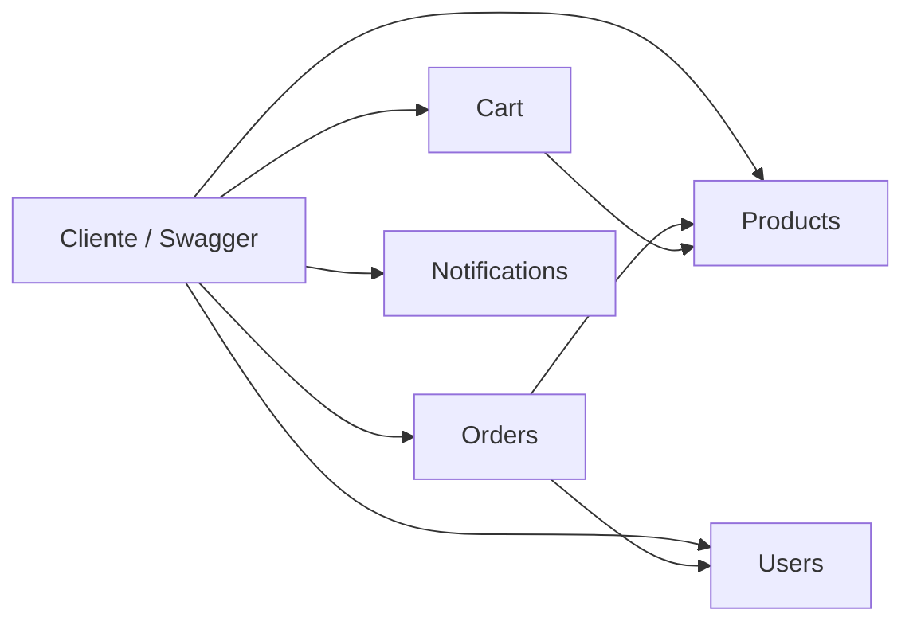

<!-- [TP Microservicios E-Commerce v7] Documento entregable: explica cómo ejecutar la solución y sus contratos principales. -->
# TP Microservicios E-Commerce v7

Implementación didáctica en .NET 10 de cinco APIs independientes para un e-commerce. El código prioriza clases chicas, nombres explícitos y reglas de negocio fáciles de seguir.

## Requisitos y ejecución

- .NET SDK 10.
- Visual Studio Code con **C# Dev Kit**, **Better Comments** y **TODO Tree**.

Restaurar, compilar y ejecutar pruebas:

```powershell
dotnet restore ECommerce.slnx
dotnet build ECommerce.slnx
dotnet test ECommerce.slnx
```

Cada API se puede iniciar desde una segunda terminal. Por ejemplo:

```powershell
dotnet run --project src/Products.API
```

En modo Development, Swagger queda disponible en `/swagger`.

## Microservicios y puertos

| Servicio | HTTP | HTTPS | Responsabilidad |
|---|---:|---:|---|
| Products | 5101 | 7101 | Catálogo y stock |
| Users | 5102 | 7102 | Registro, login y bloqueo |
| Orders | 5103 | 7103 | Órdenes y estados |
| Cart | 5104 | 7104 | Carritos e ítems |
| Notifications | 5105 | 7105 | Envío simulado e historial |



Los servicios no comparten entidades de dominio. `Shared.Contracts` contiene contratos técnicos comunes (errores y opciones) y `Shared.Infrastructure` reúne middleware, logging y el adaptador de persistencia.

## Errores de negocio

| Grupo | Códigos |
|---|---|
| Products | PRD-001 a PRD-005 |
| Users | USR-001 a USR-006 |
| Orders | ORD-001 a ORD-007 |
| Cart | CRT-001 a CRT-005 |
| Notifications | NTF-001 a NTF-004 |

Los códigos se centralizan en `ErrorCatalog`. Una `DomainException` llega al `DomainExceptionHandler`, que responde `ProblemDetails` con `errorCode`, `errorMessage` y `correlationId`.

## Decisiones de diseño

- Los DTOs públicos usan los nombres en español de la consigna; los modelos internos usan inglés.
- Todas las fechas se generan con `DateTime.UtcNow` y los identificadores con `Guid.NewGuid()`.
- Las cantidades repetidas se consolidan en Cart y Orders.
- Los estados de Orders siguen una secuencia lineal: Pendiente → Confirmada → Enviada → Entregada; la cancelación sólo es posible antes del envío.
- Products se elimina de forma definitiva. Users conserva un bloqueo persistente hasta una intervención externa.
- Se usa `PasswordHasher<User>` de ASP.NET Core para no guardar contraseñas en texto plano.
- Se agrega un `X-Correlation-Id` a solicitudes y respuestas, health checks y logs JSON con Serilog.

## Alcance de esta entrega

La persistencia actual es en memoria mediante un adaptador intercambiable. Esto permite estudiar las reglas de negocio sin introducir una base de datos antes de contar con la librería de persistencia indicada por la cátedra. Los clientes de comunicación remota están representados por interfaces para poder probar las reglas sin levantar los cinco procesos; el siguiente paso es reemplazarlos por clientes HTTP tipados configurados desde `ServiceOptions`.
