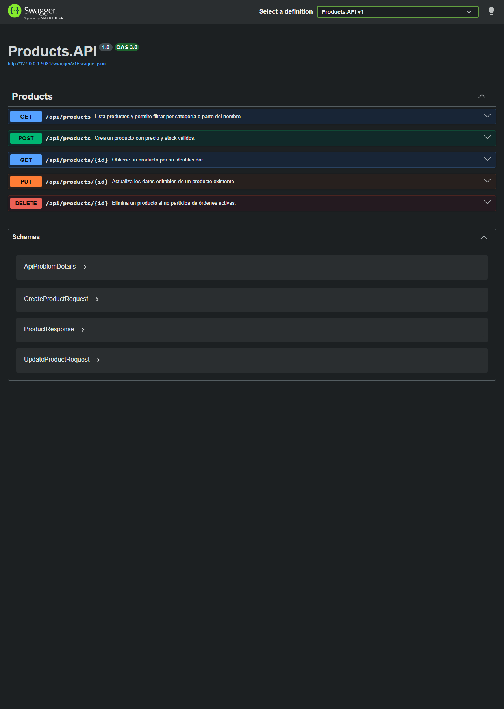
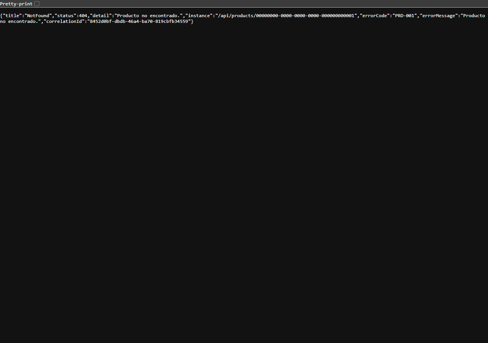
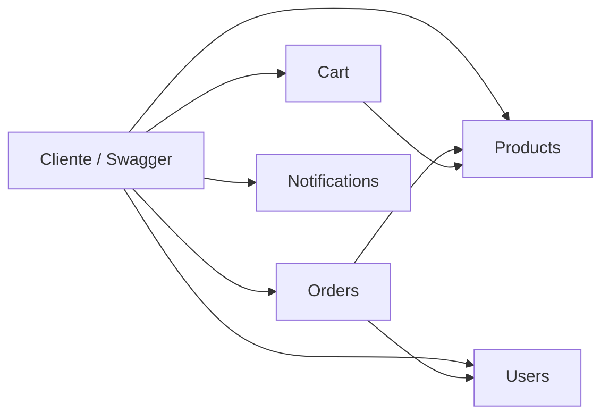

<!-- [TP Microservicios E-Commerce v7] Documento entregable: explica cómo ejecutar la solución y sus contratos principales. -->
# TP Microservicios E-Commerce v7

Implementación didáctica en .NET 10 de cinco APIs independientes para un e-commerce. El código prioriza clases chicas, nombres explícitos y reglas de negocio fáciles de seguir.

## Requisitos y ejecución

- .NET SDK 10.
- Visual Studio Code con **C# Dev Kit**, **Better Comments** y **TODO Tree**.

Restaurar, compilar y ejecutar pruebas:

```powershell
dotnet restore ECommerce.slnx
dotnet build ECommerce.slnx
dotnet test ECommerce.slnx
```

Cada API se puede iniciar desde una segunda terminal. Por ejemplo:

```powershell
dotnet run --project src/Products.API
```

En modo Development, Swagger queda disponible en `/swagger`. Cada controlador declara sus respuestas exitosas y el contrato estándar de errores (`ApiProblemDetails`), por lo que los códigos y modelos se pueden inspeccionar sin leer el código.

### Evidencia de Swagger y contrato de error

La siguiente captura muestra los endpoints documentados de Products API en Swagger.



La siguiente respuesta real corresponde a `GET /api/products/{id}` con un identificador inexistente. Se observa el código `PRD-001`, el mensaje y el `correlationId` exigidos por la consigna.



## Microservicios y puertos

| Servicio | HTTP | HTTPS | Responsabilidad |
|---|---:|---:|---|
| Products | 5101 | 7101 | Catálogo y stock |
| Users | 5102 | 7102 | Registro, login y bloqueo |
| Orders | 5103 | 7103 | Órdenes y estados |
| Cart | 5104 | 7104 | Carritos e ítems |
| Notifications | 5105 | 7105 | Envío simulado e historial |



Los servicios no comparten entidades de dominio. `Shared.Contracts` contiene contratos técnicos comunes (errores y opciones) y `Shared.Infrastructure` reúne middleware, logging y el adaptador de persistencia.

## Errores de negocio

| Grupo | Códigos |
|---|---|
| Products | PRD-001 a PRD-005 |
| Users | USR-001 a USR-006 |
| Orders | ORD-001 a ORD-007 |
| Cart | CRT-001 a CRT-005 |
| Notifications | NTF-001 a NTF-004 |

Los códigos se centralizan en `ErrorCatalog`. Una `DomainException` llega al `DomainExceptionHandler`, que responde `ProblemDetails` con `errorCode`, `errorMessage` y `correlationId`. Por ejemplo, `GET /api/products/{id}` para un identificador inexistente responde `404`:

```json
{
  "errorCode": "PRD-001",
  "errorMessage": "Producto no encontrado.",
  "correlationId": "..."
}
```

## Decisiones de diseño

- Los DTOs públicos usan los nombres en español de la consigna; los modelos internos usan inglés.
- Todas las fechas se generan con `DateTime.UtcNow` y los identificadores con `Guid.NewGuid()`.
- Las cantidades repetidas se consolidan en Cart y Orders.
- Los estados de Orders siguen una secuencia lineal: Pendiente → Confirmada → Enviada → Entregada; la cancelación sólo es posible antes del envío.
- Products se elimina de forma definitiva. Users conserva un bloqueo persistente hasta una intervención externa.
- Se usa `PasswordHasher<User>` de ASP.NET Core para no guardar contraseñas en texto plano.
- Se agrega un `X-Correlation-Id` a solicitudes y respuestas, health checks y logs JSON con Serilog.

## Persistencia y comunicación

Cada API persiste su propio estado en SQLite mediante `IEntityStore<T>` y `SqliteEntityStore<T>`. La abstracción mantiene los Services enfocados en reglas de negocio y permite a los tests usar `InMemoryEntityStore<T>`. El archivo `ecommerce.db` es local y está ignorado por Git.

La comunicación entre APIs se realiza con clientes HTTP tipados configurados desde `ServiceOptions`: Orders consulta Users y Products; Cart consulta Products; Notifications consulta Users; Products consulta Orders antes de eliminar un producto. El `CorrelationIdDelegatingHandler` propaga `X-Correlation-Id` entre esas llamadas.

## Validación de entrega

La solución se verifica con `dotnet build ECommerce.slnx` y `dotnet test ECommerce.slnx`. La suite cubre reglas representativas de cada servicio, el contrato de error, correlación, health checks y la persistencia SQLite.
